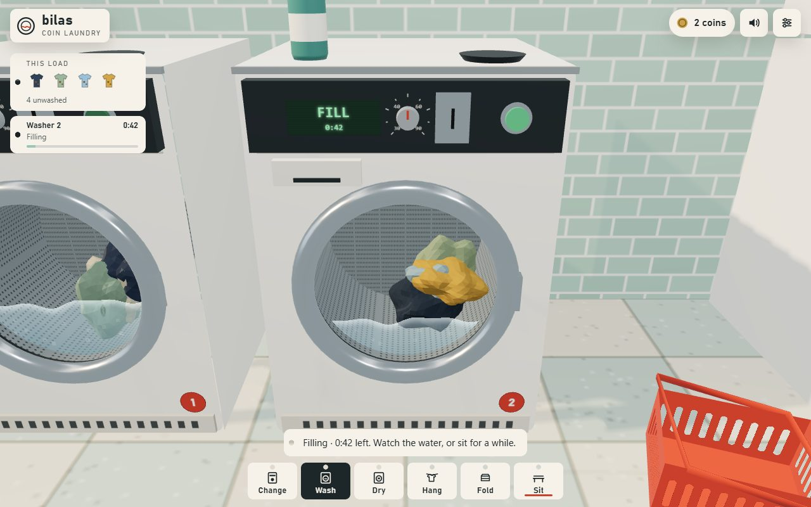
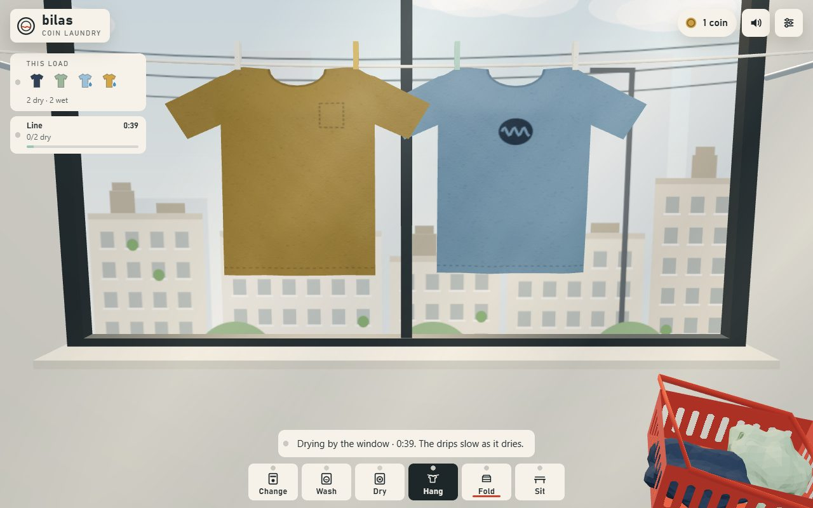
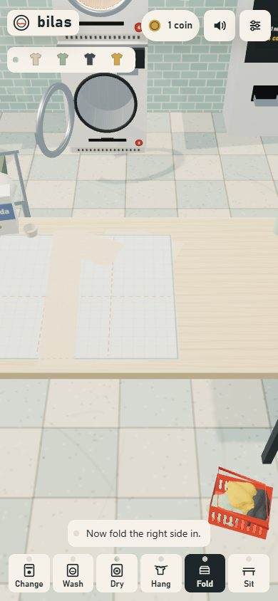

# bilas — coin laundry ASMR

A calm, first-person 3D coin laundromat. Sibling of [Jeda](https://github.com/juw12/jeda), in the spirit of Sansa (산사): no score, no timer pressure, just the sounds and small gestures of doing laundry.

**▶ Play: https://juw12.github.io/bilas/**

| Hang by the window | On a phone |
|---|---|
|  |  |

## Get it on your device
- **Desktop (Windows / macOS / Linux):** open the link in Chrome or Edge and click the install icon in the address bar (or menu → *Install Bilas*). It runs in its own window and works offline. You can also download the repo and double-click `index.html`.
- **iPhone / iPad:** open the link in **Safari** → Share → **Add to Home Screen**. It opens full screen and works offline. (Not on the App Store.)
- **Android:** download `Bilas-android.apk` from the [android release](https://github.com/juw12/bilas/releases/tag/android) and allow your browser to install it, or open the link in Chrome → menu → **Add to Home screen**.

Turn the sound on — everything you hear is synthesized live.

## What you do
1. **Change** - feed a note into the changer, scoop the coins from the tray.
2. **Wash** - open the door, load shirts one by one, pour detergent, drag coins into the slot, press start. Watch the water and foam, then the drain and spin.
3. **Dry** - drag a coin into the dryer, load, tumble, then pull the lint screen and peel the felt off.
4. **Hang** - peg wet shirts on the line by the window; the drips slow as they dry.
5. **Fold** - smooth the wrinkles by dragging, fold sleeve, sleeve, bottom up on the folding board, stack.
6. **Sit** - stay a while and listen to other customers' machines and the rain.

## Details
- three.js (bundled locally), Web Audio: about 30 synthesized sounds plus machine loops and room tone, placed in space. No audio files, no network calls.
- English / Bahasa Indonesia, night (rain) and morning themes, cycle length 45 s to 3 min.
- Installable PWA (manifest + service worker, offline). Android APK is a Capacitor wrapper of the same files, built by GitHub Actions (`mobile/`, `.github/workflows/android.yml`).
- Works on phones (tested at 320-1440 px wide). Shows a friendly message if WebGL is unavailable.

## Tests
`tests/flow.py` drives the full flow with real pointer events in headless Chromium (desktop and phone); `tests/gates.py` checks layout overflow, tap sizes, translation parity, contrast, `file://` and no-WebGL. Hone history: `hone/refine_log.md`.

## License
MIT © Juwen Lie
